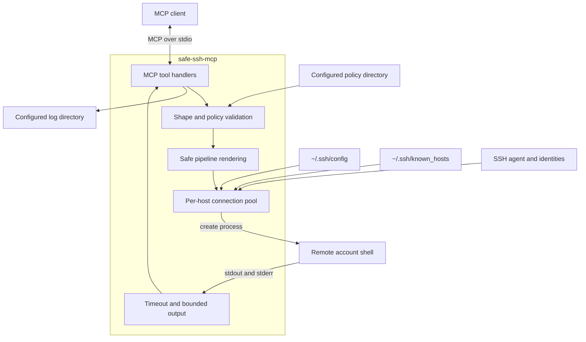
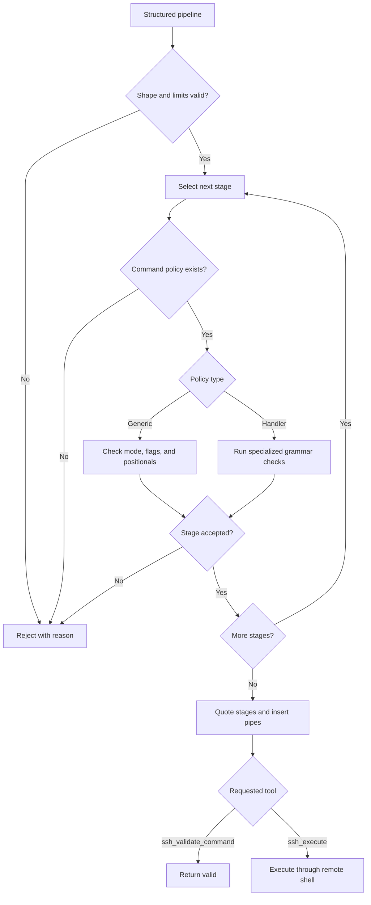
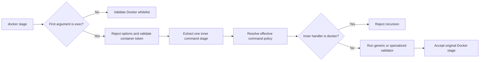

# safe-ssh-mcp: design

How [safe_ssh_mcp.py](../safe_ssh_mcp.py) works.

## Architecture



- Single Python file, MCP over stdio, built on `MCPServer` from the official `mcp` SDK (v2).
- SSH through AsyncSSH 2.24.1 or newer. AsyncSSH reads and interprets supported connection settings directly from `~/.ssh/config`.
- Authentication uses configured identities and SSH-agent keys without prompting. On native Windows, if `SSH_AUTH_SOCK` is absent, the server passes the Windows OpenSSH agent pipe `\\.\pipe\openssh-ssh-agent` explicitly. Pageant is optional.
- Every new connection verifies the server key against the explicit `~/.ssh/known_hosts` path. Unknown, changed, revoked, missing, and malformed trust data fail closed; the server never accepts or saves a key.
- The connection pool keeps at most one live AsyncSSH connection per requested host. A per-host `asyncio.Lock` serializes lookup, creation, replacement, and eviction while independent command channels can run concurrently over the healthy connection.
- A configured `ServerAliveInterval` is preserved; otherwise the server uses a 30-second keepalive interval. The failure count is bounded to three. A connection found closed before command-process creation is replaced once, but a command is never retried after process creation begins.
- MCP lifespan cleanup closes every pooled connection, awaits closure, and is safe to invoke repeatedly.
- Commands use AsyncSSH byte-stream processes. stdout and stderr are consumed concurrently, retained independently up to 50 KB, and decoded as UTF-8 with replacement for incomplete or invalid sequences.
- Every structured pipeline passes shape and policy validation before it is rendered and sent to the host.

## SSH configuration and trust

The server passes the requested hostname, address, or alias to AsyncSSH without supplying a custom configuration sequence. AsyncSSH loads `~/.ssh/config` by default and applies its supported OpenSSH client configuration, including `Host`, `Match`, `Include`, `HostName`, `User`, `Port`, `IdentityFile`, `ConnectTimeout`, `ServerAliveInterval`, `ProxyCommand`, and `ProxyJump`. This is the AsyncSSH-supported subset, not complete OpenSSH compatibility. OpenSSH-specific connection multiplexing settings such as `ControlMaster`, `ControlPath`, and `ControlPersist` are not server features.

AsyncSSH 2.24.1 requires forward slashes in absolute Windows `Include` paths. The server does not normalize these paths because doing so would reintroduce a second configuration parser. Operators using Windows absolute paths must write them as `C:/...` rather than `C:\...`.

`ssh_list_hosts` is a best-effort discovery aid, not an authorization boundary. Its small local reader lists concrete `Host` tokens found directly in the main `~/.ssh/config`; it does not follow `Include`, evaluate `Match`, or reproduce any connection setting. Consequently, AsyncSSH may successfully resolve aliases which are absent from the list, and callers may request an unlisted hostname or address. A host argument is rejected locally only when it is empty, longer than 255 characters, or contains whitespace or control characters.

Connection settings are read by AsyncSSH when a new connection is created. An already-open connection retains the settings from its handshake until it closes or the MCP server restarts. Host listing reads the main config each time `ssh_list_hosts` is called.

Every new connection receives `~/.ssh/known_hosts` explicitly. AsyncSSH supports plain and hashed host patterns and `@cert-authority` and `@revoked` markers. The path is read again for each replacement connection, so an operator-approved key takes effect without restarting the MCP server after the old connection is closed. The file is never written. For an unknown or changed key, the tool reports safe key type and SHA-256 fingerprint data when available and directs the operator to run `ssh <alias>` in a terminal. Raw host-key errors are not returned.

AsyncSSH makes one connection attempt using the trusted configuration. Host-key rejection, authentication failure, timeout, DNS failure, and other connection failures are reported once and are not retried. Encrypted private keys must already be unlocked in an agent because MCP stdio cannot provide an interactive passphrase prompt.

## Connection pool and command execution

The pool is keyed by the requested host string and keeps at most one usable connection for each key. A per-host async lock prevents concurrent first requests from creating duplicate connections and protects closed-connection replacement and eviction. It does not serialize command execution: AsyncSSH opens an independent process channel for each concurrent command on the shared connection.

Every new connection reads the trusted SSH configuration. If `ServerAliveInterval` is set, that value is used; otherwise the server enables a 30-second keepalive. `ServerAliveCountMax` is bounded to three so an unreachable peer is eventually detected. A connection which is already closed before command-process creation is removed and replaced. After process creation starts, a transport error is returned without retry because the server cannot prove that the remote command did not begin executing.

The MCP lifespan closes all pooled connections and awaits local closure. Cleanup removes the pool entries first and may be called repeatedly without closing a connection twice.

Command execution creates a process with `encoding=None` and stdin disconnected. stdout and stderr are read concurrently so either remote stream can continue draining its SSH window. Each reader retains at most `MAX_RESPONSE_BYTES` and probes at most one byte beyond the limit. If either stream exceeds the limit, the process channel is closed, the retained bytes are decoded as UTF-8 with replacement behavior, and the result reports truncation with the exit status unavailable. Below the limits, the final pipeline stage's exit status is returned unchanged.

One deadline covers process creation, concurrent reads, and process completion. A timeout or MCP cancellation closes the process channel and awaits bounded local channel cleanup before propagating. The pooled connection is retained when AsyncSSH still reports it usable and evicted when it reports itself closed.

## Command validation

`ssh_execute` and `ssh_validate_command` accept a `pipeline` array. Each stage contains exactly a `command` string and an `arguments` array of strings. A single command is represented by a one-stage pipeline.

The server checks the pipeline shape and limits, then validates every stage independently against `COMMAND_POLICIES`. It renders each stage with `shlex.join` and inserts ` | ` between stages. The agent cannot provide shell operators: values such as `$HOME`, `$(whoami)`, `>`, `&&`, `*`, and `error|warning` are quoted as literal arguments. Redirections, command lists, substitutions, expansions, glob syntax, and background execution have no structured representation.



The rendered pipeline is sent through the SSH account's configured remote shell, as raw commands were before this change. The returned exit status is therefore the final pipeline stage's status. A fixed Bash wrapper was rejected because it would introduce a new remote prerequisite solely for `pipefail`; see [ADR 004](adr/004-structured-command-pipeline.md).

`COMMAND_POLICIES` is built entirely from the `*.yaml` and `*.yml` files in the effective policy directory. This is [policies/](../policies/) by default or the complete replacement directory selected by `SAFE_SSH_MCP_POLICY_DIR`. YAML owns command-specific permissions. Python owns pipeline shape, safe serialization, and specialized value-aware handler implementations because those are executable validation boundaries rather than declarative policy.

A pipeline is rejected when:

- its shape is invalid or a structural limit is exceeded
- any stage's command is not in `COMMAND_POLICIES`
- any stage's arguments break the rules of the command's mode
- a command-specific handler rejects an argument value

Each generic command policy has a mode:

- `permissive` allows every flag and positional argument. It is only suitable for commands whose complete argument grammar is read-only, such as `ls`, `cat`, `grep`, and `ps`.
- `blacklist` allows every flag except the structured `flags` entries, which identify blocked flags and whether they have attached or inline values. It is suitable only when unrestricted positional arguments cannot select modifying behavior.
- `whitelist` allows only the structured `flags` entries. An optional `positional_variants` field can define the complete allowed positional grammar.
- A handler policy delegates command-specific grammar to a deny-by-default Python validator. `curl` uses this mode because destination, credential, and data-input validation cannot be expressed safely through generic flag patterns alone. Docker composes handler and whitelist behavior: ordinary inspection uses its declarative positional variants, while `docker exec` delegates its inner command back to the shared command-policy validator.

Every `flags` item contains `flag` and the required `value_pattern` field. A regular-expression string means the flag requires exactly one value; explicit `null` means the flag accepts no value. Patterns use case-sensitive full-string matching. The validator accepts separate and inline long values (`--output file` and `--output=file`) and separate and attached short values (`-n 100` and `-n100`). An exact declared flag takes precedence over attached-value parsing. Short bundles such as `-tzv` are accepted only when `allows_flag_bundling: true`, after exact-flag and attached-value interpretations fail. An exact `--` token ends option parsing.

`require_flags` lists normalized flags that must be present. For example, `ping` requires `-c` and its value pattern limits the count to 1 through 100.

In whitelist mode, `positional_variants` is authoritative when present and unrestricted positional behavior is preserved when it is omitted. An array variant contains one regular expression per positional token and therefore has exact arity; `[]` explicitly permits no positional arguments. A bounded-rest variant contains fixed `args`, a `rest_pattern`, and finite `min_rest` and `max_rest` values. A command is accepted when one entire variant matches.

Policy files are trusted operator configuration and must not be populated from remote or untrusted sources. Files load in deterministic filename order, and every command must be defined exactly once. At startup the loader rejects a missing or empty policy directory, malformed YAML, duplicate mapping keys, command names repeated across files, unknown fields, legacy string-only flags, missing `value_pattern` fields, invalid variant shapes, invalid regular expressions, patterns longer than 1,024 characters, `positional_variants` outside whitelist mode, and Docker handler policies which do not retain a whitelist and positional variants. It compiles each regular expression once. Before matching, it rejects flag values and positional tokens longer than 4,096 characters.

### Policy-validated Docker execution

The bundled Docker policy enables `handler: docker`. The handler preserves the existing inspection whitelist and additionally accepts one nested command boundary:

```text
docker exec <container> <command> [arguments...]
```



The container may be any non-option name or ID reference accepted by Docker and is not allowlisted. Docker remains authoritative for resolving that reference. Docker exec options are rejected, and an inner Docker handler invocation is rejected. All other inner commands use the same effective policies as top-level stages, including specialized handlers such as `curl`. The handler validates the structured arguments directly and does not introduce `sh -c` or another shell layer.

This design intentionally treats a command allowed on the host as allowed in every reachable container. Policy activation is server-wide. To disable `docker exec` while retaining Docker inspection, remove `handler: docker` from `policies/docker.yaml`, keep its whitelist and positional variants, and restart the server. See [ADR 006](adr/006-policy-validated-docker-exec.md).

## Runtime directories

- `SAFE_SSH_MCP_POLICY_DIR` selects the complete effective policy directory. It does not extend or merge with the packaged policy.
- `SAFE_SSH_MCP_LOG_DIR` selects the log directory.
- When a variable is omitted, the corresponding default is `policies/` or `.logs/` beside `safe_ssh_mcp.py`.
- Absolute paths are used directly. Relative paths are resolved from the directory containing `safe_ssh_mcp.py`, making them independent of the MCP client's working directory.
- An empty environment value is invalid. A missing or empty policy directory and a log directory which cannot be created or opened stop startup.

Runtime initialization configures logging before loading policy files, so policy-load events are recorded. Importing the module performs neither operation and does not create `.logs/` during test discovery or library use.

`awk` and `sed` are not allowed at all: they can run commands and write files from inside their scripts, which flag checks cannot see. The reasoning is in [ADR 002](adr/002-mvp-command-whitelist.md).

The unrestricted positional grammar of every shipped permissive policy was reviewed:

- File and path readers (`ls`, `cat`, `pwd`, `file`, `stat`, `du`, `df`, `basename`, `dirname`) use positionals only to select data to read or format.
- Text and data processors (`grep`, `head`, `tail`, `wc`, `uniq`, `cut`, `tr`, `diff`, `comm`, `jq`) produce output on stdout and have no argument-selected modifying subcommand.
- Identity and system readers (`whoami`, `uname`, `which`, `id`, `uptime`) report information without an argument-selected modifying subcommand. `hostname` is instead a whitelist policy that permits only the no-argument read form.
- Process, archive, and network readers (`ps`, `top`, `free`, `zipinfo`, `netstat`, `iostat`) expose inspection and formatting arguments but no argument-selected modifying subcommand. `ss` is instead a blacklist policy that blocks its socket-terminating `-K` and `--kill` options.

### Residual policy limitation

- `positional_variants` is deliberately unavailable in blacklist and permissive modes. Those modes accept undeclared flags, so the validator cannot know whether a following token is that flag's value or a positional argument. Use whitelist mode for commands such as `systemctl` and `docker`, where a positional subcommand selects behavior.

## Limits

- Pipeline stages: 16 (`MAX_PIPELINE_STAGES`).
- Arguments per stage: 128 (`MAX_ARGUMENTS_PER_STAGE`).
- Command, argument, or policy-matched token: 4,096 characters (`MAX_POLICY_TOKEN_LENGTH`).
- Rendered pipeline: 65,536 UTF-8 bytes (`MAX_RENDERED_PIPELINE_LENGTH`).
- Policy regular expression: 1,024 characters (`MAX_PATTERN_LENGTH`).
- Connect timeout: the AsyncSSH/OpenSSH configuration value when set.
- Command timeout: 10 seconds (`COMMAND_TIMEOUT_SECONDS`).
- stdout and stderr: 50 KB retained independently (`MAX_RESPONSE_BYTES`). Exceeding either limit closes the command channel and returns a truncation marker with the exit status unavailable.

The server exposes no download or other local file-write tool. Agents inspect remote files through validated `ssh_execute` commands such as `cat`, `head`, `tail`, or `sed`, subject to the command timeout and response limits above. A future transfer tool requires a separate design with server-chosen local destinations and streaming limits.

## Layout

- [safe_ssh_mcp.sh](../safe_ssh_mcp.sh) - root Bash launcher. It resolves the server relative to itself, supports `--runner auto|uv|pipx`, prefers uv in automatic mode, uses pipx 1.12.0 or newer with the `pip` backend, and writes launcher diagnostics only to stderr so stdout remains available for MCP. Explicit runner selection never falls back; `--` forwards remaining arguments to the server.
- [safe_ssh_mcp.py](../safe_ssh_mcp.py) - the whole server. Its header declares the Python version and dependencies as [inline script metadata](https://packaging.python.org/en/latest/specifications/inline-script-metadata/), which `uv run` reads. It validates structured pipelines and YAML policies, safely serializes pipeline stages, and implements specialized handlers.
- [policies/](../policies/) - the default complete command-specific policy. `*.yaml` and `*.yml` files are loaded in filename order at startup; duplicate command definitions are rejected. `core.yaml` owns the base commands, `example.yaml.template` is not loaded, and `policy.schema.json` provides editor validation but is ignored by the runtime loader. Explicit modelines select the schema instead of broad Schema Store matches; runtime validation remains authoritative. `SAFE_SSH_MCP_POLICY_DIR` replaces this directory.
- [prompts/](../prompts/) - general security and operational-health assessment prompts for agents.
- [tests/](../tests/) - unit, transport, launcher, limit, logging, discovery, and policy-validation tests. Run the complete unit suite with `uv run --with-requirements safe_ssh_mcp.py python -m unittest discover -s tests -t . -p 'test_*.py'`.
- `.logs/` - the default log directory, created at startup with one `{YYMMDDHHmm}-{pid}.log` per server process. `SAFE_SSH_MCP_LOG_DIR` replaces this location. Log files are ignored by git.
- [docs/](.) - this documentation.

The launcher and server remain at the repository root because they are the public entrypoint and application. No `scripts/` directory is needed unless maintenance, release, or migration utilities are added later.

## Logging

Logs go to the log file and to stderr (stdout carries the MCP protocol):

```text
[2025-11-14 10:30:45.123] operator@example-web: connection established
[2025-11-14 10:30:45.234] example-web: connection reused
[2025-11-14 10:30:45.456] operator@example-web: journalctl -u app -n 100 | grep error
[2025-11-14 10:30:45.789] operator@example-web: exit_code=0
[2025-11-14 10:30:46.012] operator@example-web: REJECTED - rm -rf /tmp/x - Reason: Pipeline stage 1: command 'rm' is not allowed in safe mode. ...
```

Also logged: timeouts, output truncation, and loaded policy files.

## History

- [ADR 001: Bash command validation](adr/001-bashlex.md) -- superseded
- [ADR 002: MVP command whitelist](adr/002-mvp-command-whitelist.md)
- [ADR 003: Target-allowlisted curl handler](adr/003-curl-handler.md)
- [ADR 004: Structured command pipeline](adr/004-structured-command-pipeline.md)
- [ADR 005: AsyncSSH transport and strict host trust](adr/005-asyncssh-transport.md)
- [ADR 006: Policy-validated Docker execution](adr/006-policy-validated-docker-exec.md)
